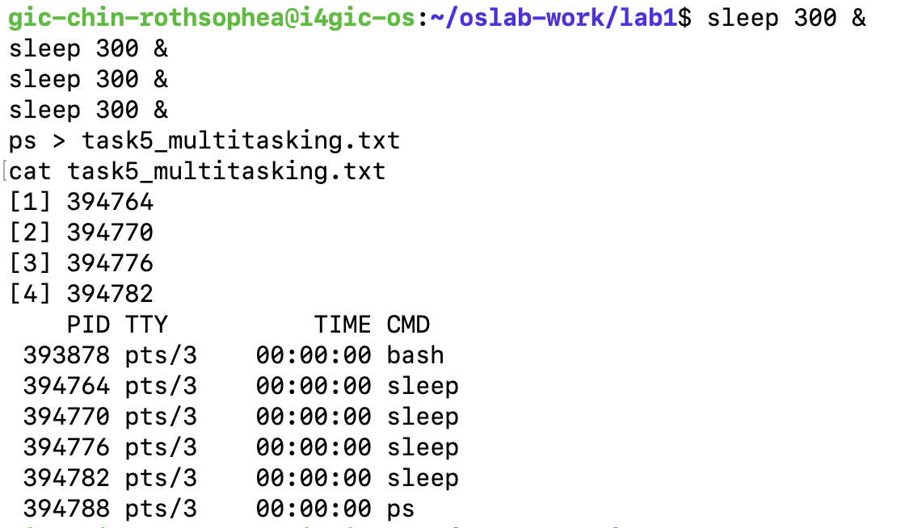
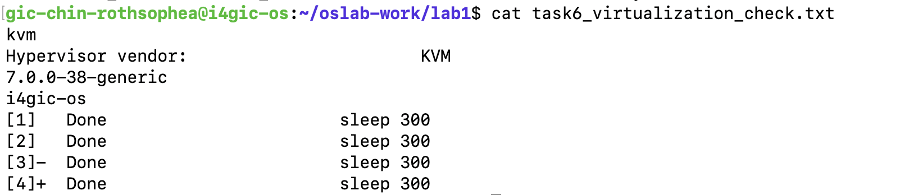

# Lab 1 Report: Operating System Basics

## Task 1 — Which System Is This?
* **Kernel Version:** `7.0.0-38-generic`
* **Ubuntu Version:** `Ubuntu 26.04.1 LTS` (Release: `26.04`)

## Task 2 — Files and Folders
* **Working Folder:** `/home/gic-chin-rothsophea/oslab-work/lab1/task2_files`
* **Final Files Present:** `silver.txt` and `bridge_renamed.txt`

## Task 4 — Program or Process?
* **Program Path:** `/usr/bin/sleep`
* **Observations:** Executing `sleep 30 &` created an active process in memory with a unique PID, which terminated after completion while the static program file remained on disk.

## Task 5 — Multitasking
* Successfully ran 4 concurrent instances of `sleep` simultaneously in the background.
* **Screenshot (`task5.png`):**
  

## Task 6 — Is This a Virtual Machine?
* **Detection Result:** `kvm` (Hypervisor vendor: `KVM`)
* **Screenshot (`task6.png`):**
  
