# Class Activity 1 — System Calls in Practice

- **Student Name:** Chin Rothsophea
- **Student ID:** e20230592
- **Date:** October 25, 2026

---

## Warm-Up: Hello System Call

- Screenshot of running `hello_syscall.c` on Linux: 
- Screenshot of running `hello_winapi.c` on Windows: 
- Screenshot of running `copyfilesyscall.c` on Linux: 

---

## Task 1: File Creator & Reader

### Part A — File Creator
**Describe your implementation:** 
The library version (`file_creator_lib.c`) uses high-level wrapper functions (`fopen()`, `fprintf()`) which manage buffers and stream states automatically. The system call version (`file_creator_sys.c`) directly invokes the kernel via `open()` with specific flags (`O_WRONLY | O_CREAT | O_TRUNC`) and writes data using `write()` descriptors.

- **Version A — Library Functions (`file_creator_lib.c`):** 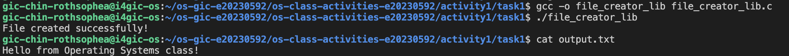
- **Version B — POSIX System Calls (`file_creator_sys.c`):** 

#### Questions:
1. **What flags did you pass to `open()`? What does each flag mean?**
   > `O_WRONLY` (open for writing only), `O_CREAT` (create file if it doesn't exist), and `O_TRUNC` (truncate file to 0 length if it exists).

2. **What is `0644` in the permission argument? What does each digit represent?**
   > `0644` represents octal permissions: owner has read and write (`6`), group has read-only (`4`), and others have read-only (`4`).

3. **What does `fopen("output.txt", "w")` do internally that you had to do manually with `open()`?**
   > It allocates a `FILE` structure buffer, handles stream buffering, checks error codes, and internally executes the low-level `open()`, memory allocation, and flags configuration.

---

### Part B — File Reader & Display
- **Version A — Library Functions (`file_reader_lib.c`):** 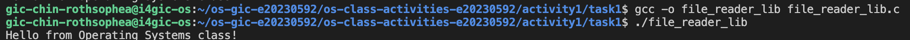
- **Version B — POSIX System Calls (`file_reader_sys.c`):** 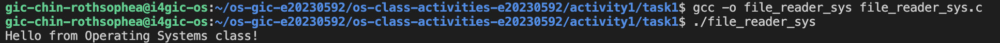

#### Questions:
1. **What does `read()` return? How is this different from `fgets()`?**
   > `read()` returns the number of bytes read as a `ssize_t` (`0` on EOF, `-1` on error). `fgets()` returns a pointer to the buffer string (`NULL` on EOF/error) and automatically handles null-termination.

2. **Why do you need a loop when using `read()`? When does it stop?**
   > A single `read()` call may not consume an entire file at once depending on buffer limits. The loop continues reading chunk-by-chunk until `read()` returns `0`, signaling the End-Of-File (EOF).

---

## Task 2: Directory Listing & File Info

**Describe your implementation:**
Version A uses `opendir()` and high-level `printf()` formatting. Version B replaces `printf()` with low-level `write()` by first formatting directory entry metadata into a character buffer using `snprintf()`.

- **Version A — Library Functions (`dir_list_lib.c`):** 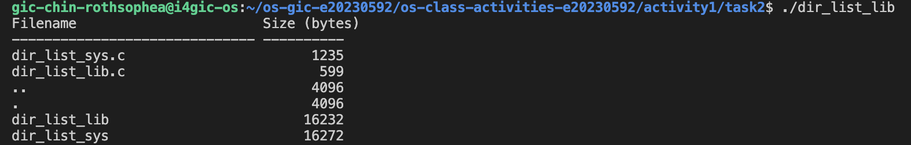
- **Version B — System Calls (`dir_list_sys.c`):** 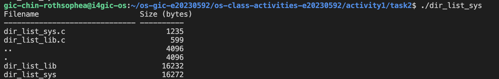

### Questions:
1. **What struct does `readdir()` return? What fields does it contain?**
   > It returns a pointer to a `struct dirent`. Key fields include `d_name` (filename string) and `d_ino` (inode number).

2. **What information does `stat()` provide beyond file size?**
   > It provides file permission bits (`st_mode`), owner IDs (`st_uid`, `st_gid`), hard link counts (`st_nlink`), and access/modification timestamps (`st_atime`, `st_mtime`).

3. **Why can't you just `write()` a number directly — why do you need `snprintf()` first?**
   > `write()` expects a raw byte buffer of characters. File sizes are stored as binary numeric integers in memory, so `snprintf()` translates them into human-readable character strings before output.

---

## Optional Bonus: Windows API (`file_creator_win.c`)

- Screenshot of running on Windows: 

### Bonus Questions:
1. **Why does Windows use `HANDLE` instead of integer file descriptors?**
   > Windows handles are opaque pointers to kernel object tables rather than raw integer indices into a process-specific file descriptor array.

2. **What is the Windows equivalent of POSIX `fork()`? Why is it different?**
   > The equivalent is `CreateProcess()`. Unlike `fork()`, which duplicates the existing address space, `CreateProcess()` initializes a brand-new process address space explicitly.

3. **Can you use POSIX calls on Windows?**
   > Yes, through compatibility layers or environments such as WSL (Windows Subsystem for Linux) or Cygwin.

---

## Task 3: strace Analysis

**Describe what you observed:**
The library version executes significantly more system calls due to dynamic linker lookups (`/etc/ld.so.cache`, `libc.so.6`), memory allocation initialization (`brk`, `mmap`), and stream buffer management, whereas the system call version interacts with the kernel directly and minimally.

- **strace Output — Library Version (File Creator):** 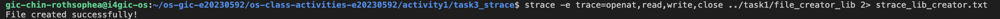
- **strace Output — System Call Version (File Creator):** 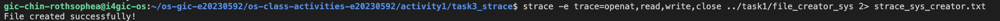
- **strace Output — Library Version (File Reader):** 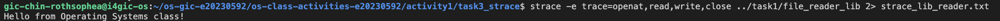
- **strace Output — System Call Version (File Reader):** 
- **strace -c Summary Comparison:** 
  - Library: 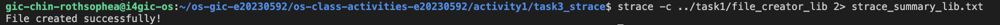
  - Syscall: 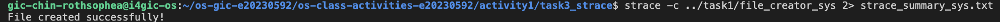

### Questions:
1. **How many system calls does the library version make compared to the system call version?**
   > The library version triggers dozens of setup calls (`brk`, `mmap`, `mprotect`, `arch_prctl`), while the system call version invokes only essential operations (`openat`, `write`, `close`, `exit_group`).

2. **What extra system calls appear in the library version? What do they do?**
   > `brk` and `mmap` allocate heap memory and set up internal buffers; `mprotect` adjusts memory page protection flags.

3. **How many `write()` calls does `fprintf()` actually produce?**
   > It buffers text internally and executes a single buffered `write()` call upon flushing or closing.

4. **In your own words, what is the real difference between a library function and a system call?**
   > A library function is user-space helper code handling formatting and buffering, whereas a system call is the secure, privileged entry point requesting direct kernel intervention.

---

## Task 4: Exploring OS Structure

- **System Information (`uname -a`, `/proc/cpuinfo`, `/proc/meminfo`, `/proc/version`, `/proc/uptime`):** 
  - Kernel: `Linux i4gic-os 7.0.0-38-generic #38-Ubuntu SMP PREEMPT_DYNAMIC`
  - CPU: `Intel(R) Xeon(R) CPU E5-2630 v4 @ 2.20GHz`
  - Memory: `MemTotal: 7600784 kB`
  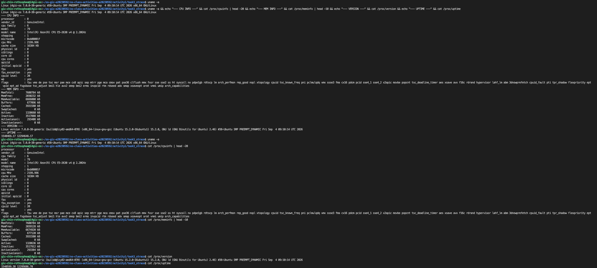
- **Process Information (`/proc/self` & `ps aux`):** 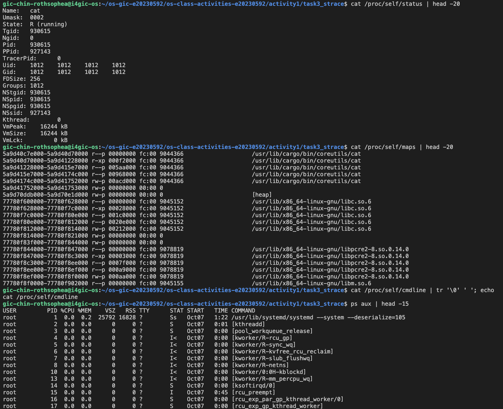
- **Kernel Modules (`lsmod` & `modinfo bochs`):** 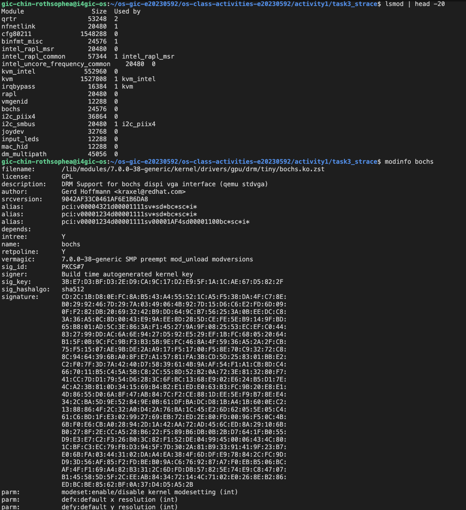
- **OS Layers Diagram:** 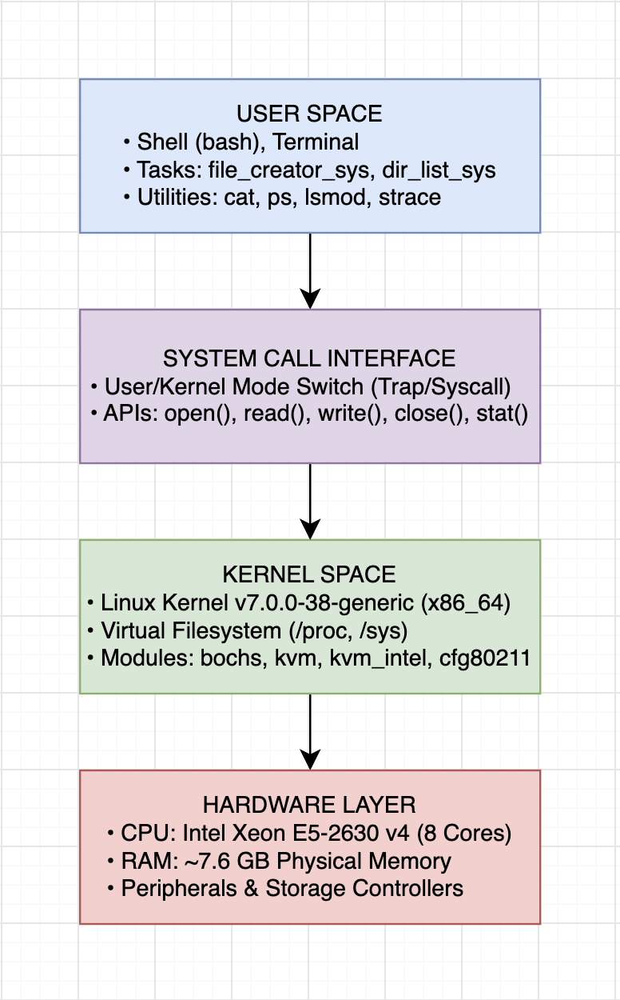

### Questions:
1. **What is `/proc`? Is it a real filesystem on disk?**
   > It is a virtual (pseudo) filesystem generated dynamically in real-time by the Linux kernel; it occupies no actual physical disk space.

2. **Monolithic kernel vs. microkernel — which type does Linux use?**
   > Linux uses a modular monolithic kernel, maintaining performance advantages while allowing dynamic module loading/unloading (as seen with `lsmod` and `modinfo`).

3. **What memory regions do you see in `/proc/self/maps`?**
   > Code (text) segments, data segments, heap allocations, shared library mappings (`libc.so.6`), and the program stack.

4. **Break down the kernel version string from `uname -a`.**
   > It details the OS name (`Linux`), hostname (`i4gic-os`), release version (`7.0.0-38-generic`), symmetric multiprocessing (SMP) build configuration, and target CPU architecture (`x86_64`).

5. **How does `/proc` show that the OS is an intermediary between programs and hardware?**
   > User programs make standard system calls to read `/proc` virtual files, and the kernel intercepts these requests to fetch live state from hardware and kernel subsystems safely.

---

## Reflection
This activity provided clear, empirical insight into the OS layered architecture. Comparing manual system calls with library wrappers through `strace` and exploring the `/proc` virtual filesystem demystified how user-space applications communicate securely with the Linux kernel and underlying hardware.
