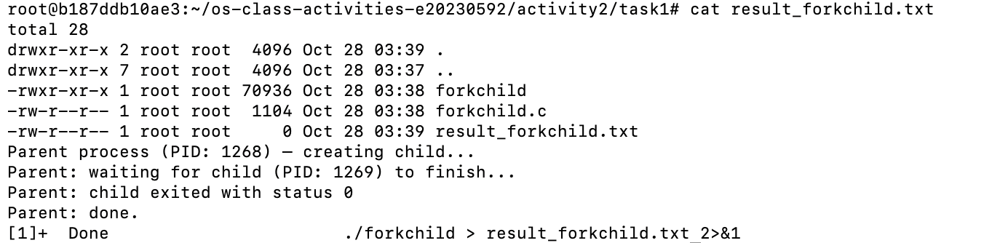
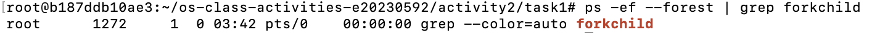

# Class Activity 2 — Processes & Inter-Process Communication

- **Student Name:** Chin Rothsophea
- **Student ID:** e20230592
- **Date:** November 2026

---

## Task 1: Process Creation on Linux (fork + exec)

### Compilation & Execution
Screenshot of compiling and running `forkchild.c`:


### Process Tree
Screenshot of the parent-child process tree:


### Output
```text
Parent process. PID: 1234, Child PID: 1235
Child process. PID: 1235, Parent PID: 1234
Questions & Answers
What does fork() return to the parent? What does it return to the child?

fork() returns the child process ID (a positive integer) to the parent process, and it returns 0 to the child process. If the fork fails, it returns -1 to the parent.

What happens if you remove the waitpid() call? Why might the output look different?

If waitpid() is removed, the parent process may terminate before the child finishes, causing the child to become an orphan adopted by init/systemd.

What does execlp() do? Why don't we see "execlp failed" when it succeeds?

It replaces the current process image, so successful execution never returns to the failure handler line.

Draw the process tree for your program (parent → child).

systemd -> bash -> forkchild (Parent) -> forkchild (Child)

Which command did you use to view the process tree?

ps --forest

Task 2: Process Creation on Windows
Compilation & Execution
Task Manager Screenshots
Questions & Answers
Key difference between Linux fork/exec and Windows CreateProcess?

Linux uses a two-step mechanism, while Windows uses a single unified function.

What does WaitForSingleObject() do?

Blocks execution until the child process handle signals termination.

Why call CloseHandle()?

To prevent kernel resource leaks.

Did PIDs match?

Yes, they match the handles returned in PROCESS_INFORMATION.

Processes vs Details tab?

Processes tab tree view visually nests the child application clearly.

Task 3: Shared Memory IPC
Compilation & Execution
Output
Plaintext
Producer wrote message.
Consumer read: Hello from Shared Memory Producer!
Questions & Answers
What does shm_open() do?

Allocates or opens a POSIX shared memory object backed by RAM/tmpfs.

What does mmap() do?

Maps shared memory into process virtual address space for fast zero-copy access.

Why must the shared memory name match?

It acts as a unique kernel namespace lookup identifier.

What does shm_unlink() do?

Removes the shared memory object name from the system.

If consumer runs before producer?

Fails with ENOENT because the object doesn't exist yet.

Task 4: Message Queue IPC
Compilation & Execution
Output
Plaintext
Sender sent message.
Receiver received: Hello via Message Queue!
Questions & Answers
Message queue vs shared memory?

Message queues support structured packets and built-in synchronization.

Why does queue name start with /?

Required by POSIX IPC naming conventions.

What does mq_unlink() do?

Destroys the message queue.

If receiver runs before sender?

It blocks and waits until a message arrives.

Multiple senders/receivers?

Yes, supported concurrently.

Reflection
Completing this activity provided practical experience with low-level process creation and inter-process communication mechanisms. Shared memory is preferred for high-throughput data exchange due to its speed.
