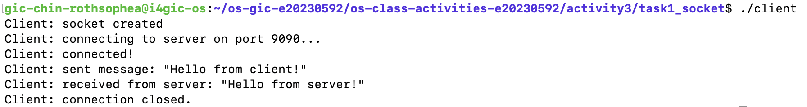
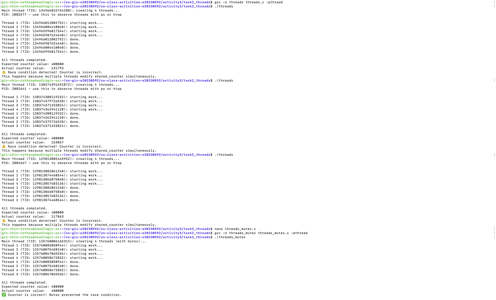
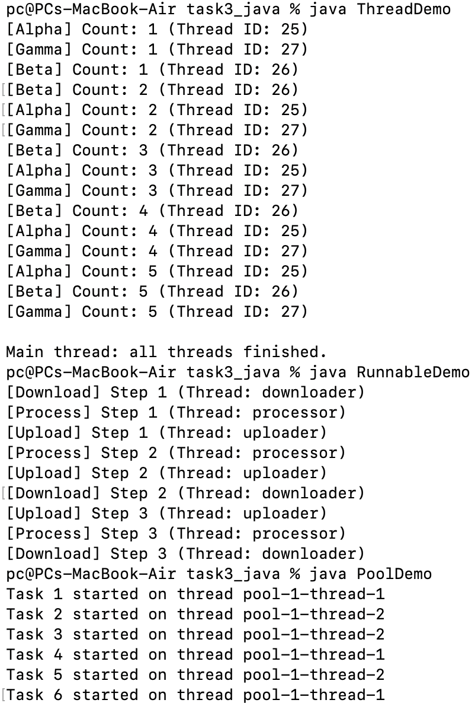

# Class Activity 3 — Socket Communication & Multithreading

- **Student Name:** Chin Rothsophea
- **Student ID:** e20230592
- **Date:** November 16, 2026

---

## Task 1: TCP Socket Communication (C)

### Compilation & Execution



### Answers

1. **Role of `bind()` / Why client doesn't call it:**
   > `bind()` assigns a specific local IP address and port number to a socket so the operating system knows where to route incoming network packets. The server calls `bind()` because it needs to listen on a well-known, predictable port. Clients typically do not call `bind()` explicitly because the operating system automatically assigns a random ephemeral port when `connect()` is invoked.

2. **What `accept()` returns:**
   > `accept()` returns a **new connected socket descriptor** dedicated exclusively to communicating with that specific client. The original listening socket remains open and unbound to any individual client, ready to accept subsequent incoming connections.

3. **Starting client before server:**
   > If you start the client before the server, the connection attempt fails immediately with a `Connection refused` error because no process is actively listening on that port and IP address.

4. **What `htons()` does:**
   > `htons()` stands for **"Host TO Network Short"**. It converts a 16-bit integer from host byte order (which can be little-endian depending on the CPU architecture) to network byte order (big-endian), ensuring correct cross-platform communication over the network.

5. **Socket call sequence diagram:**
   > ```text
   > Server                      Client
   > ------                      ------
   > socket()                    socket()
   > bind()
   > listen()
   > accept() <--- (Blocking) --- connect()
   > read/write <==============> read/write
   > close()                     close()
   > ```

---

## Task 2: POSIX Threads (C)

### Output — Without Mutex (Race Condition)



### Output — With Mutex (Correct)


### Answers

1. **What is a race condition?**
   > A race condition occurs when multiple threads access and manipulate shared data concurrently, and the final outcome depends on the non-deterministic interleaving or execution order of the threads, leading to data corruption or incorrect results.

2. **What does `pthread_mutex_lock()` do?**
   > It acquires a mutual exclusion lock. If another thread currently holds the lock, the calling thread blocks and suspends execution until the lock is released, ensuring safe, exclusive access to the critical section.

3. **Removing `pthread_join()`:**
   > If `pthread_join()` is omitted, the main thread may reach the end of `main()` and terminate the entire process before the spawned worker threads finish executing, causing them to be abruptly killed.

4. **Thread vs Process:**
   > Processes have fully isolated memory spaces and resources, requiring explicit Inter-Process Communication (IPC) to share data. Threads within the same process share the same virtual memory space, heap, and file descriptors, making context switching and data sharing much faster but requiring careful synchronization.

---

## Task 3: Java Multithreading

### ThreadDemo Output



### RunnableDemo Output


### PoolDemo Output


### Answers

1. **Thread vs Runnable:**
   > Extending `Thread` creates a dedicated thread class but limits single inheritance in Java. Implementing `Runnable` defines a task that can be executed by any thread (or thread pool), promoting better separation of concerns and reusability.

2. **Pool size limiting concurrency:**
   > An `ExecutorService` thread pool restricts the maximum number of concurrent active threads to the configured pool size. Excess tasks are queued up and processed sequentially as threads become available, preventing CPU and memory exhaustion.

3. **thread.join() in Java:**
   > `thread.join()` causes the currently executing thread to wait and pause execution until the target thread finishes its task completely.

4. **ExecutorService advantages:**
   > `ExecutorService` automates thread lifecycle management, reuses threads via pools to eliminate thread creation overhead, handles task queues seamlessly, and simplifies asynchronous execution and result tracking through `Future` objects.

---

## Task 4: Observing Threads

### Linux — `ps -eLf` Output

```bash
gic-chin-rothsophea@i4gic-os:~$ ps -eLf | grep threads_observe
gic-chin+ 2349707 2349707 2349707     5  5 14:34 pts/3    00:00:00 ./threads_observe
gic-chin+ 2349707 2349707 2349709     5  5 14:34 pts/3    00:00:00 ./threads_observe
gic-chin+ 2349707 2349707 2349710     5  5 14:34 pts/3    00:00:00 ./threads_observe
gic-chin+ 2349707 2349707 2349711     5  5 14:34 pts/3    00:00:00 ./threads_observe
gic-chin+ 2349707 2349707 2349712     5  5 14:34 pts/3    00:00:00 ./threads_observe
Linux — htop Thread View
Linux — htop Kernel Threads (tree view, kthreadd)
Linux — Kernel Threads (commands)
Plaintext
=== /proc/2349707/task/ listing ===
2349707
2349709
2349710
2349711
2349712
Thread count: 5

=== kthreadd children ===
PID   PPID PSR COMMAND
  3      2   0 pool_workqueue_release
  4      2   0 kworker/R-rcu_gp
  5      2   0 kworker/R-sync_wq
Windows — Task Manager
Answers
LWP column meaning:
LWP stands for Light Weight Process ID. In Linux, threads are implemented as kernel-scheduled tasks, and each thread has a unique LWP ID corresponding to its Thread ID (TID).

/proc/PID/task/ count:
The directory contains subdirectories named after each individual thread's TID belonging to that process. The total count matches the number of active threads (NLWP).

Extra Java threads:
The JVM runs several background system threads alongside user application threads, such as the Garbage Collector (GC), Reference Handler, Signal Dispatcher, and JIT compiler threads.

Linux vs Windows thread viewing:
Linux treats threads as tasks sharing resources via clone flags (viewable via ps -eLf, /proc, and htop), whereas Windows maintains distinct kernel structures for processes (EPROCESS) and threads (ETHREAD), viewed through Task Manager or Process Explorer.

kthreadd and three kernel threads:
kthreadd (PID 2) is the parent kernel process that manages and spawns all kernel-level threads. Three examples include:
kworker: Handles deferred kernel work queues.
ksoftirqd: Handles soft interrupt processing.
migration: Manages CPU load balancing and thread migration across cores.
TID equal to PID, NLWP and cores:
For the main thread of a process, its Thread ID (TID/LWP) is identical to the Process ID (PID). NLWP represents the number of lightweight processes (threads) active in that task. PSR indicates the specific CPU core the thread is currently executing on.

H and K in htop:
In htop, pressing H toggles the display of user-space threads, and pressing K toggles the visibility of kernel threads.

Reflection
Exploring socket communication and multithreading at the operating system level bridges the gap between abstract programming concepts and actual hardware execution. Understanding socket primitives (bind, listen, accept, connect) clarifies how network layers operate, while examining threads, race conditions, mutexes, and kernel structures like kthreadd provides vital insight into concurrency management. Mastering these mechanisms is essential for building robust, high-performance, and thread-safe distributed systems.
