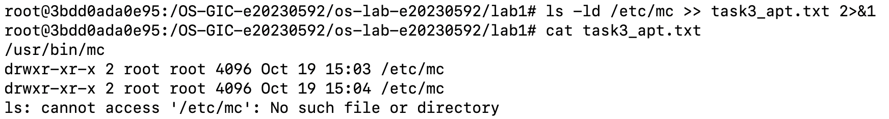

# Lab 1 Report: Operating System Basics

- Student Name: Chin Rothsophea
- Student ID: e20230592
- Ubuntu username on the server: gic-chin-rothsophea
- My values (oslab values lab1): file1 = silver, file2 = bridge, count = 3

## Task 1: Which System Is This?
* **Kernel Version:** `7.0.0-38-generic`
* **Ubuntu Version:** `Ubuntu 26.04.1 LTS (Release: 26.04)`

## Task 2: Files and Folders
* **Working Folder:** `/home/gic-chin-rothsophea/oslab-work/lab1/task2`
* **Final Files Present:** `FILE1.txt` and `FILE2_renamed.txt`

## Task 3: Package Management
* **Package Managed:** `mc`
* **Observations:**
  - Installing `mc` created `/usr/bin/mc` and `/etc/mc`.
  - Removing `mc` uninstalled `/usr/bin/mc`, leaving `/etc/mc`.
  - Purging `mc` completely deleted `/etc/mc`.
* **Screenshot:**
  

## Task 4: Program or Process?
* **Program Path:** `/usr/bin/sleep`
* **Observations:** Executing `sleep 30 &` created an active process running in the background.

## Task 5: Multitasking
* **Description:** Successfully ran 4 concurrent instances of `sleep` simultaneously.
* **Screenshot:**
  

## Task 6: Is This a Virtual Machine?
* **Detection Result:** `kvm` (Hypervisor vendor: `KVM`)
* **Screenshot:**
  

## My Prediction: Confirmed or Corrected
* **Prediction 1:** Confirmed. The process list clearly distinguished active running process instances from static binary files on disk.
* **Prediction 2:** Confirmed. Multitasking allowed multiple background tasks to run concurrently without blocking the terminal.
* **Prediction 3 (apt-get remove vs purge):** Confirmed. `remove` retained configuration files in `/etc/mc`, while `purge` completely deleted them.
